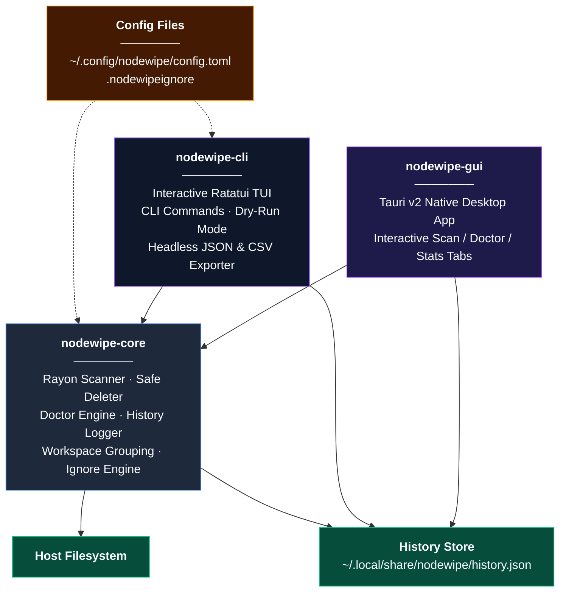

<div align="center">

  <p align="center">
    <picture>
      <source media="(prefers-color-scheme: dark)" srcset="./assets/logo-dark.svg">
      <source media="(prefers-color-scheme: light)" srcset="./assets/logo-light.svg">
      
    </picture>
  </p>

  **The surgical, blazing-fast dev-environment cleaner written in Rust.**  
  *Reclaim tens of gigabytes from orphaned `node_modules`, Rust `target/`, Python `venv`s, AI/ML model weights, and native/mobile build caches across 39+ ecosystems.*

  <br>

  [](https://github.com/KADHIRAVANEG/nodewipe/releases)
  [](https://github.com/KADHIRAVANEG/nodewipe/stargazers)
  [](https://www.npmjs.com/package/@joker53/nodewipe)
  [](https://aur.archlinux.org/packages/nodewipe)
  [](https://www.npmjs.com/package/@joker53/nodewipe)
  [](LICENSE)
  [](https://github.com/KADHIRAVANEG/nodewipe/actions)

  <br>

  <p align="center">
    <strong>⭐ Enjoying nodewipe? Please consider starring the repository on GitHub to help others discover it!</strong>
  </p>

  <br><br>

  

  <br><br>

  [**Website & Live Demo**](https://joker53.me/nodewipe/) •
  [**Installation**](#-installation) •
  [**Key Features**](#-key-features) •
  [**Supported Ecosystems**](#-supported-ecosystems) •
  [**Interactive TUI**](#-interactive-tui--dry-run-mode) •
  [**System Doctor**](#-system-doctor-nodewipe-doctor) •
  [**Desktop GUI**](#-desktop-gui) •
  [**CLI Cheat Sheet**](#-cli-cheat-sheet)

</div>

---

## ⚡ Key Features

* **🚀 Blazingly Fast**: Parallel directory traversal and physical filesystem block analysis (`st_blocks * 512`) powered by `rayon`. Scans hundreds of thousands of folders in seconds.
* **🌐 39+ Ecosystems Covered**: Not just `node_modules` — handles Rust `target/`, Python `venv` / caches, C/C++ & Native (CMake, Ninja, Zig, Elixir, Meson), modern web (Astro, SvelteKit, Nuxt, Docusaurus, Vite, Playwright, Cypress, Yarn offline cache, pnpm `.ignored`), AI/ML models (Hugging Face, Ollama, PyTorch, Triton), Mobile & Apple (Xcode DerivedData, SwiftPM, CocoaPods, Gradle cache, Android cache), Java Maven & Gradle, Go caches, .NET `bin/obj`, PHP `vendor`, Next.js, and Turborepo.
* **🧠 Decision Intelligence & Directory Inspector**: `nodewipe explain <path>` (or <kbd>e</kbd> in TUI) provides clear explanations for each result: why it matched, whether it can be recreated, git branch staleness, risk rating, and exact recovery command.
* **🎯 Targeted Reclaim Engine**: Free up an exact storage budget (`nodewipe reclaim 10GB`) with risk scoring, prioritizing zero-download local rebuilds first.
* **📋 Named Profiles & Saved Presets**: Intent-driven cleanups (`--profile build-outputs`, `old-dependencies`, `large-models`) and reusable saved workflows (`nodewipe preset save/run`).
* **🌳 Storage Explorer & Drill-Down**: Inspect internal layout of massive artifacts (`nodewipe tree <path>` or <kbd>v</kbd> in TUI) to see which subpackages, incremental builds, or caches consume disk space.
* **⏱️ Project Activity Timeline**: Correlate Source modification vs Git commits vs Build output timestamps (`nodewipe timeline <path>`) to differentiate fresh builds from abandoned ones.
* **🏢 Deep Monorepo Workspace Analytics**: Multi-package rollups and deduplication insights (`nodewipe workspace <path>`) for pnpm, Cargo, Turborepo, Nx, and Lerna.
* **📌 Project Pinning Protection**: Mark active projects as pinned (`nodewipe pin add` or <kbd>p</kbd> in TUI). Pinned projects and all their artifacts are strictly locked and refused by the deletion engine.
* **🛡️ Zero-Risk Excision & CoW Archiving**: Moves to OS Trash by default. Supports instant Copy-on-Write (`reflink`) snapshotting on Btrfs/XFS/APFS with 0ms overhead, with automatic fallback to compressed `.tar.gz` archiving.
* **🔍 Interactive TUI with Dry-Run Mode**: Full keyboard navigation, multi-select, and instant dry-run simulation (<kbd>P</kbd>) before touching a single byte.
* **🩺 System Doctor**: `nodewipe doctor ~` analyzes disk-hog distribution across every toolchain and identifies abandoned build outputs.
* **📦 Monorepo & Workspace Aware**: Automatically groups nested packages and monorepo roots (`pnpm`, `Cargo`, `Turborepo`, `Nx`) with interactive expand/collapse.
* **📊 Lifetime Savings Dashboard**: Track every byte reclaimed over time (`nodewipe stats`) with a 30-day interactive history chart.
* **🖥️ Native Desktop GUI**: A lightweight, responsive Tauri desktop app wrapping the exact same high-speed Rust engine.

---

## 📦 Installation

Choose your preferred installation method:

### 1. NPM (No Rust toolchain required)
Installs a lightweight shim that automatically fetches the matching native binary for your OS and architecture:
```bash
# Run instantly with npx:
npx @joker53/nodewipe

# Or install globally:
npm install -g @joker53/nodewipe
```

### 2. Homebrew (macOS & Linux)
Install via the official Homebrew tap:
```bash
brew install kadhiravaneg/nodewipe/nodewipe
```

### 3. Arch Linux (AUR)
Maintained in the official Arch User Repository:
```bash
yay -S nodewipe
# or: paru -S nodewipe
```

### 4. Windows (Winget & Scoop)
Install via Microsoft Winget:
```powershell
winget install nodewipe
```
Or via Scoop:
```powershell
scoop install https://raw.githubusercontent.com/KADHIRAVANEG/nodewipe/main/packaging/scoop/nodewipe.json
```

### 5. Universal Shell Installer
Interactive installer with support for CLI-only or CLI + Desktop GUI:
```bash
curl -fsSL https://raw.githubusercontent.com/KADHIRAVANEG/nodewipe/main/install.sh | bash
```

### 6. Docker
Run isolated scans without installing anything on your host machine:
```bash
# Scan current directory:
docker run --rm -v "$PWD":/scan ghcr.io/joker-53/nodewipe

# Interactive TUI inside Docker (requires TTY):
docker run --rm -it -v ~/Projects:/scan ghcr.io/joker-53/nodewipe scan
```

### 7. GitHub Action (CI/CD)
Automatically reclaim runner disk space before Docker builds or large test matrices:
```yaml
- name: Free Runner Disk Space
  uses: KADHIRAVANEG/nodewipe/.github/actions/nodewipe@main
  with:
    path: '.'
    mode: 'delete'
    older-than: '24h'
```

### 8. Build from Source (Cargo)
```bash
cargo build --release
./target/release/nodewipe
```

> [!TIP]
> Precompiled standalone binaries for **Linux (x86_64, aarch64)**, **macOS (Intel & Apple Silicon)**, and **Windows (x86_64)** are available on the [GitHub Releases page](https://github.com/KADHIRAVANEG/nodewipe/releases).

---

## 🌐 Supported Ecosystems

`nodewipe` uses strict **marker validation** to avoid false positives. A directory named `target`, `build`, or `dist` is only considered disposable if confirmed by sibling configuration files:

| Ecosystem | Artifact Name | Slug | Marker Validation |
|---|---|---|---|
| **Node.js** | `node_modules` | `node_modules` | Directory name (identifies `npm`, `yarn`, `pnpm` from lockfile) |
| **Python** | `venv`, `.venv` | `venv` | Contains `pyvenv.cfg` inside |
| **Python** | `__pycache__` | `pycache` | Directory name |
| **Python** | `.pytest_cache` | `pytest_cache` | Directory name |
| **Python** | `.mypy_cache` | `mypy_cache` | Directory name |
| **Python** | `.ruff_cache` | `ruff_cache` | Directory name |
| **Rust** | `target/` | `rust_target` | Sibling `Cargo.toml` exists |
| **Java** | `target/` | `maven_target` | Sibling `pom.xml` exists |
| **Java** | `build/` | `gradle_build` | Sibling `build.gradle` or `build.gradle.kts` exists |
| **Go** | `pkg/mod` | `go_mod_cache` | Sibling `go.mod` or `go.sum` exists |
| **Go** | `go-build/` | `go_build_cache` | Directory name (`.cache/go-build`) |
| **PHP** | `vendor/` | `php_vendor` | Sibling `composer.json` exists |
| **.NET** | `bin/` | `dotnet_bin` | Sibling `*proj` project file exists |
| **.NET** | `obj/` | `dotnet_obj` | Sibling `*proj` project file exists |
| **Next.js** | `.next` | `next_cache` | Directory name |
| **Turborepo**| `.turbo` | `turbo_cache` | Directory name |
| **Bundlers**| `dist/` | `dist` | Sibling `package.json` or `pyproject.toml` exists |
| **AI / HF** | `hub/` | `hf_cache` | Parent `huggingface` or contains `version.txt` |
| **AI / Ollama** | `models/` | `ollama_models` | Parent `.ollama` directory |
| **AI / PyTorch** | `torch/` | `torch_cache` | Parent `.cache` or contains checkpoints/kernels |
| **AI / Triton** | `cache/` | `triton_cache` | Parent `.triton` directory |
| **Apple / Xcode** | `DerivedData` | `derived_data` | Parent `Xcode` or contains ModuleCache/Build |
| **Apple / Swift** | `.build/` | `swiftpm_build` | Sibling `Package.swift` exists |
| **iOS / CocoaPods** | `Pods/` | `cocoapods` | Sibling `Podfile` exists |
| **Android / Gradle**| `caches/` | `gradle_cache` | Parent `.gradle` directory |
| **Android SDK** | `build-cache/` | `android_build_cache` | Parent `.android` directory |
| **Testing / Web** | `ms-playwright` | `playwright_browsers` | Directory name |
| **Testing / Web** | `Cypress` | `cypress_cache` | Parent `.cache` or `Caches` |
| **Astro** | `.astro/` | `astro_cache` | Sibling `astro.config.*` or `package.json` |
| **SvelteKit** | `.svelte-kit/` | `sveltekit_cache` | Sibling `svelte.config.*` or `package.json` |
| **Nuxt** | `.nuxt/` | `nuxt_cache` | Sibling `nuxt.config.*` or `package.json` |
| **Docusaurus** | `.docusaurus/` | `docusaurus_cache` | Sibling `docusaurus.config.*` or `package.json` |
| **Vite** | `.vite/` | `vite_cache` | Sibling `vite.config.*` or `package.json` |
| **C / C++ (CMake)**| `build/` | `cmake_build` | Sibling `CMakeLists.txt` or contains `CMakeCache.txt` |
| **Zig** | `.zig-cache/` | `zig_cache` | Sibling `build.zig` or directory name |
| **Elixir / Erlang**| `_build/` | `elixir_build` | Sibling `mix.exs` |
| **Meson** | `builddir/` | `meson_build` | Sibling `meson.build` or contains `meson-private` |
| **pnpm** | `.ignored` | `pnpm_ignored` | Parent `node_modules` or adjacent `package.json`/`pnpm-lock.yaml` |
| **Yarn** | `v6` | `yarn_cache` | Parent `yarn` or `Yarn` cache directory (`~/.cache/yarn/v6`) |

List all supported types and slugs at any time with:
```bash
nodewipe types
```

---

## 💻 Interactive TUI & Dry-Run Mode

Launching `nodewipe` with no arguments in a terminal opens the **Ratatui-powered interactive TUI**:

<div align="center">
  
</div>

### TUI Keyboard Shortcuts

| Key | Action |
|---|---|
| <kbd>↑</kbd> / <kbd>↓</kbd> or <kbd>k</kbd> / <kbd>j</kbd> | Move cursor up / down |
| <kbd>PgUp</kbd> / <kbd>PgDn</kbd> | Jump cursor up / down by visible page height |
| <kbd>Home</kbd> / <kbd>End</kbd> | Jump to first / last entry |
| <kbd>Space</kbd> | Toggle selection for the focused directory |
| <kbd>A</kbd> | **Select all** / Deselect all entries |
| <kbd>Enter</kbd> | Select all entries within the highlighted monorepo workspace group |
| <kbd>g</kbd> | **Toggle Monorepo Grouped View** (Collapses subprojects under workspace root) |
| <kbd>Tab</kbd> | Expand / Collapse highlighted monorepo group |
| <kbd>f</kbd> | **Cycle Age Filter** (`All` → `>30d` → `>60d` → `>90d` → `>180d` → `>1y`) |
| <kbd>e</kbd> | **Directory Inspector Modal** (Explain detection rationale, risk level, git status & recovery recipe) |
| <kbd>p</kbd> | **Pin / Unpin Project** (Protect active project and its artifacts from deletion) |
| <kbd>b</kbd> | **Rebuild / Reinstall** toolchain dependencies in-place (`npm`, `pnpm`, `cargo`, `uv`, etc.) |
| <kbd>y</kbd> | **Copy path** to system clipboard |
| <kbd>o</kbd> | **Open directory** in system file manager (`xdg-open`, `open`, `explorer`) |
| <kbd>i</kbd> | Add highlighted artifact path to `.nodewipeignore` |
| <kbd>I</kbd> | Open interactive **Ignored Patterns Manager** (view & remove ignored patterns) |
| <kbd>t</kbd> | Open interactive **Type Filter Screen** (<kbd>s</kbd> solo type, <kbd>i</kbd> invert selection) |
| <kbd>d</kbd> | **Delete to Trash** (Recoverable via OS recycle bin) |
| <kbd>a</kbd> | **Archive & Delete** (Creates `.tar.gz` or instant CoW `.snapshot` backup) |
| <kbd>x</kbd> | **Permanent Delete** (Unrecoverable — prompts for confirmation) |
| <kbd>P</kbd> | **Toggle Dry-Run Preview Mode** (Simulate recovery with zero risk) |
| <kbd>R</kbd> | **Restore View** (Browse & restore `.tar.gz` and `.snapshot` archives) |
| <kbd>r</kbd> | Rescan current path |
| <kbd>q</kbd> / <kbd>Esc</kbd> | Quit nodewipe |

### Dry-Run Simulation Mode

Press <kbd>P</kbd> at any time in the TUI to activate **Dry-Run Mode**. It calculates the exact amount of space you would free and verifies file access without deleting or moving anything:

<div align="center">
  
</div>

---

## 🧠 Decision Intelligence & Project Pinning

`nodewipe` transforms everyday cleanup from a guessing game into an informed, safe decision.

### 1. Directory Inspector (`nodewipe explain <path>`)
Explains *why* any folder matched, its risk level, whether rebuild requires network downloads or only local compilation, recent Git activity, and the exact command to recover it:

```bash
nodewipe explain ~/Projects/my-rust-app/target
```

```text
Explanation for /home/kadhir/Projects/my-rust-app/target
────────────────────────────────────────────────────────────────────────
  • Path:           /home/kadhir/Projects/my-rust-app/target
  • Size:           34.45 GB (36995727920 bytes)
  • Artifact Type:   Cargo target (rust_target)
  • Detection:      Detected as Rust compiler build output because 'Cargo.toml' exists in the project root.
  • Protection:     Unpinned (Eligible for cleanup)
  • Risk Level:     Low Risk — Low (Safe to delete, rebuilds locally)
                    Zero data loss risk. Recreated locally by running 'cargo build' (no network download needed).

  • Source Activity:
    - Description:  Source code touched today (actively developing project)
    - Days Inactive: 0 days

  • Git Repository:
    - Branch:        main
    - Working Tree: Clean

  • Recovery Recipe:
    - Command:       cargo build
    - Directory:    /home/kadhir/Projects/my-rust-app
────────────────────────────────────────────────────────────────────────
```

> [!TIP]
> In the interactive TUI, press <kbd>e</kbd> on any highlighted row to open the full Inspector modal.

### 2. Active Project Pinning (`nodewipe pin`)
Protect actively developing repositories from accidental cleanup. Pinned projects and all nested artifacts within them are strictly excluded from deletion:

```bash
# Pin an active project
nodewipe pin add ~/Projects/critical-client-app --reason "Release in progress"

# View all pinned projects
nodewipe pin list

# Unpin when ready
nodewipe pin remove ~/Projects/critical-client-app
```

> [!TIP]
> In the interactive TUI, press <kbd>p</kbd> on any row to toggle its pin status in real time. Pinned entries are clearly marked with ` [PINNED]`.

---

## 🎯 Targeted Reclaim, Cleanup Profiles & Presets

Need to free up a specific amount of disk space quickly? Want repeatable one-command cleanups for your developer setup? `nodewipe` provides intelligent budget-guided reclamation and saved workflow presets:

### 1. Storage Budget Reclaim (`nodewipe reclaim <TARGET>`)
Target an exact storage amount (e.g. `10GB`, `500MB`). `nodewipe` evaluates risk scores, prioritizing zero-download local compiler rebuilds (like Rust `target/` or Go build cache) over remote dependency downloads, factoring in source staleness and Git branch merge status:

```bash
# Preview what would be deleted to free up 10 GB (dry-run)
nodewipe reclaim 10GB --dry-run

# Reclaim 5 GB prioritizing local rebuilds with safe Trash mode
nodewipe reclaim 5GB --prefer-local-rebuild

# Headless JSON output for CI or storage alert webhooks
nodewipe reclaim 20GB --json
```

```text
  nodewipe reclaim — analyzing candidates in . …

 Target budget: 10.00 GB

 Proposed Cleanup Plan:
 ────────────────────────────────────────────────────────────────────────────────
 Ecosystem                      Size   Risk        Path
 ────────────────────────────────────────────────────────────────────────────────
  Cargo target             34.83 GB   Low         ./target
     Rebuild recipe: cargo build
 ────────────────────────────────────────────────────────────────────────────────
 Total Proposed: 34.83 GB (Target: 10.00 GB)
```

### 2. Intent-Based Cleanup Profiles (`--profile <NAME>`)
Filter artifacts according to your immediate goal across `scan`, `doctor`, and `reclaim`:

| Profile | Slug | Target Ecosystems | Description |
|:---|:---:|:---|:---|
| **Old Dependencies** | `old-dependencies` | `node_modules`, `venv`, `vendor`, `cocoapods` | Inactive dependencies (>60d) with remote lockfiles |
| **Build Outputs** | `build-outputs` | `target`, `dist`, `bin`, `obj`, `build` | 100% locally recompilable outputs (0 network needed) |
| **Large Models** | `large-models` | Hugging Face, Ollama, PyTorch, Triton | Gigabyte-scale AI/ML weights and compiler caches |
| **Safe Sweep** | `safe-sweep` | Build outputs, pycache, pytest, ruff | Zero-risk local artifacts with zero remote re-downloads |

```bash
# Doctor analysis focused exclusively on build outputs
nodewipe doctor --profile build-outputs

# Scan only AI/ML model caches
nodewipe scan --profile large-models

# Reclaim 15GB targeting only old dependencies
nodewipe reclaim 15GB --profile old-dependencies
```

### 3. Repeatable Workflow Presets (`nodewipe preset`)
Save complex scanning and cleaning parameters as named presets stored in `~/.config/nodewipe/config.toml`:

```bash
# Save a preset for your daily work routine
nodewipe preset save work-sweep --path ~/Projects --profile build-outputs --min-mb 50

# List all saved presets
nodewipe preset list

# Run a preset anytime
nodewipe preset run work-sweep

# Delete a preset
nodewipe preset remove work-sweep
```

---

## 🌳 Storage Explorer, Project Timeline & Monorepo Analytics

### 1. Artifact Subdirectory Drill-Down (`nodewipe tree <path>`)
Inspect what's eating up storage inside oversized artifacts (e.g. `target/`, `node_modules/`) without external tools:

```bash
# Inspect top subdirectories inside target/
nodewipe tree ./target --depth 2 --limit 5
```

```text
  Storage Explorer — ./target

  target/ (34.83 GB)
 ├──  debug/ (32.10 GB · 92.2%)
 │   ├──  incremental/ (18.40 GB · 52.8%)
 │   ├──  deps/ (11.20 GB · 32.2%)
 │   └──  build/ (2.50 GB · 7.2%)
 └──  release/ (2.73 GB · 7.8%)
```

> [!TIP]
> In the interactive TUI, press <kbd>v</kbd> on any row to instantly open the Storage Tree Drill-Down modal!

### 2. Multi-Timestamp Project Activity Timeline (`nodewipe timeline <path>`)
Compare the chronological relationship between your **Source Code**, **Git Commits**, and **Build Artifacts** to determine whether a build is active, stale, or abandoned:

```bash
nodewipe timeline .
```

```text
  Project Timeline: /home/kadhir/Projects/npkill-rs
 ──────────────────────────────────────────────────────────────────────
 • Source Code:    today (0 days ago)
 • Build Output:   ./target (7 days ago)
 • Git Status:      feature/phase3-storage-explorer (clean, commit 0d ago)
 • Verdict:        Stale Build (Source Modified Since)
   Summary:        Source files were modified after this artifact was created. The build is already out of date.
   Action:         Safe to delete: compiler/bundler will rebuild anyway on next run.
 ──────────────────────────────────────────────────────────────────────
```

### 3. Monorepo Workspace Analytics (`nodewipe workspace <path>`)
Aggregate disk consumption across all subpackages in pnpm, Cargo, Turborepo, Nx, and Lerna monorepos:

```bash
nodewipe workspace .
```

```text
  Workspace Analysis: /home/kadhir/Projects/npkill-rs (Cargo workspace)

 Total Artifact Footprint: 34.83 GB across 2 member packages
 Shared Root Artifacts:    34.58 GB

 Member Packages (sorted by size):
 ────────────────────────────────────────────────────────────────────────
 • core                             250.00 MB  (1 artifacts)
 • cli                                0.00 B  (0 artifacts)
 ────────────────────────────────────────────────────────────────────────
 Recommendations:
  Root workspace dependencies consume 34.58 GB.
```

---

## 🩺 System Doctor (`nodewipe doctor`)

Analyze where your storage is disappearing across all developer environments. `nodewipe doctor` scans recursively, computes aggregate totals by ecosystem, and surfaces the oldest untouched artifacts:

```bash
nodewipe doctor ~
```

<div align="center">
  
</div>

```text
  nodewipe doctor — scanning /home/kadhir …

 Total reclaimable: 45.5 GB across 163 artifact directories

 Ecosystem                 Count        Total   Oldest      Oldest path
 ────────────────────────────────────────────────────────────────────────────────
  Cargo target                6      40.3 GB   20 days     /home/kadhir/rust/target
  node_modules               17       2.7 GB   95 days     /home/kadhir/.config/opencode/node_modules
  Python venv                14       1.9 GB  167 days     /home/kadhir/Projects/.../venv
  Playwright browsers         1     314.6 MB   24 days     /home/kadhir/.cache/ms-playwright
  PHP vendor                  2     103.3 MB   54 days     /home/kadhir/HUNT/october/vendor
  dist/                      23      71.7 MB   83 days     /home/kadhir/Projects/.../dist
  Go build cache              1      61.7 MB   40 days     /home/kadhir/.cache/go-build
  Gradle build                1      15.5 MB   24 days     /home/kadhir/Projects/.../build
  __pycache__                89      14.7 MB   57 days     /home/kadhir/Projects/.../__pycache__
  .pytest_cache               7     140.0 KB   83 days     /home/kadhir/Projects/.../.pytest_cache
 ────────────────────────────────────────────────────────────────────────────────

 Top space consumers:
   34.6 GB  (6d ago)   /home/kadhir/Projects/nodewipe/target
    1.9 GB  (11d ago)  /home/kadhir/Projects/Citycraft/target
    1.2 GB  (34d ago)  /home/kadhir/Projects/crashandlearn/venv
```

---

## 🖥️ Desktop GUI

`nodewipe` includes an optional native desktop application built with **Tauri v2** and Vanilla JS for near-zero memory footprint:

```bash
nodewipe gui
```

<div align="center">
  
</div>

* **🔍 Scan Tab**: Real-time path filtering, ecosystem filter chips, sortable columns, and collapsible monorepo tree view.
* **🩺 Doctor Tab**: High-level ecosystem breakdown table and top disk hogs.
* **📊 Stats Tab**: Visual bar chart of historical savings over the last 30 days.

---

## 📊 Lifetime Stats (`nodewipe stats`)

Every deletion made through the CLI, TUI, or GUI is recorded to `~/.local/share/nodewipe/history.json`. Review your all-time disk savings with:

```bash
nodewipe stats
```

```text
  nodewipe stats — lifetime savings

 Total freed:  23.7 GB across 63 deletions

 By ecosystem:
 ────────────────────────────────────────────────────────
  node_modules          31     340.2 MB   last: today
  rust_target           12      14.2 GB   last: 3 days ago
  python_venv            9       2.1 GB   last: 14 days ago

 Last 30 days:
  2026-08-20  ████████████████  2.1 GB (4 deletions)
  2026-08-23  ████              512 MB (1 deletion)
  2026-08-27  ████████████████████████  340.2 MB (1 deletion)
```

---

## 📖 CLI Cheat Sheet

```bash
# ── Scanning ────────────────────────────────────────────────────────────────
nodewipe scan                              # Scan current directory
nodewipe scan ~/Projects                   # Scan specific path
nodewipe scan ~ --min-mb 100               # Only surface artifacts >= 100 MB
nodewipe scan ~ --grouped                  # Group by monorepo/workspace root
nodewipe scan ~ --sort age                 # Sort oldest to newest
nodewipe scan ~ --older-than 30d           # Only show artifacts untouched for 30+ days
nodewipe scan ~ --stale-days 60            # Flag projects with source untouched in 60+ days
nodewipe scan ~ --types node_modules,venv  # Target only specific types (also: --include-types, --target)
nodewipe scan ~ --preset python            # Scan only Python artifacts (node, rust, java, go)
nodewipe scan ~ --exclude-types venv,dist  # Skip specific types
nodewipe scan ~ --export audit.csv         # Export results to CSV or JSON
nodewipe scan ~ --serial                   # Single-threaded traversal fallback
nodewipe scan ~ --json                     # Headless JSON output for CI/automation

# ── Decision Intelligence & Safety ──────────────────────────────────────────
nodewipe explain .                         # Explain artifact match, risk level, git status & recovery recipe
nodewipe explain ./target --json           # Headless JSON output of directory inspection
nodewipe pin list                          # List all pinned (deletion-protected) projects
nodewipe pin add ~/Projects/my-app         # Pin project to prevent accidental deletion
nodewipe pin remove ~/Projects/my-app      # Unpin project

# ── Targeted Reclaim & Guided Workflows ─────────────────────────────────────
nodewipe reclaim 10GB                      # Interactive targeted storage budget reclaim
nodewipe reclaim 5GB --dry-run             # Preview proposed candidates without deleting
nodewipe reclaim 2GB --prefer-local-rebuild # Prioritize local compiler outputs (0 network)
nodewipe reclaim 15GB --profile old-dependencies # Reclaim targeting inactive dependencies
nodewipe preset save daily --profile build-outputs --min-mb 50 # Save reusable workflow
nodewipe preset list                       # List saved workflow presets
nodewipe preset run daily                  # Execute saved preset workflow
nodewipe preset remove daily               # Remove saved preset

# ── Deleting & Restoring ───────────────────────────────────────────────────
nodewipe delete ./path/node_modules --yes                 # Safe delete (OS Trash)
nodewipe delete ./path/target --mode archive --yes       # Compressed tar.gz or CoW snapshot backup + delete
nodewipe delete ./path/venv --mode permanent --yes       # Immediate permanent delete
nodewipe delete ./path/node_modules --dry-run            # Preview deletion impact
nodewipe restore ./path/app-target-backup.tar.gz         # Restore an archived backup (.tar.gz or .snapshot)

# ── Ignore & Configuration Management ──────────────────────────────────────
nodewipe config path                       # Show configuration file path
nodewipe config show                       # View active configuration settings
nodewipe config init                       # Initialize ~/.config/nodewipe/config.toml
nodewipe ignore list                       # List all global and local ignore patterns
nodewipe ignore add ./legacy-app           # Add path to ignore list
nodewipe ignore remove ./legacy-app        # Remove path from ignore list

# ── Analysis & Tooling ──────────────────────────────────────────────────────
nodewipe tree ./target --depth 2           # Inspect internal storage layout & largest subdirs
nodewipe timeline .                        # Compare source vs git vs build timestamps & staleness
nodewipe workspace .                       # Analyze monorepo member packages & shared root artifacts
nodewipe doctor ~                          # Run system-wide disk-hog analysis
nodewipe stats                             # Lifetime savings breakdown and bar chart
nodewipe types                             # List all supported artifact types & slugs
nodewipe man --install                     # Install system man page (~/.local/share/man/man1/)
nodewipe completions bash > ~/.local/share/bash-completion/completions/nodewipe
nodewipe gui                               # Launch desktop GUI
```

---

## ⚙️ Configuration

### `.nodewipeignore`
Place a `.nodewipeignore` file in your scan root (or in `~/.nodewipeignore` for global defaults). Supports standard `.gitignore` glob syntax:

```gitignore
# Ignore legacy projects or critical directories
archive/**
apps/production-app/node_modules
!apps/experimental/node_modules
```

Bypass ignore files with `--no-ignore-file`.

### Global Config (`~/.config/nodewipe/config.toml`)
```toml
# Set default deletion mode: "trash" | "archive" | "permanent"
default_delete_mode = "trash"

# Types to automatically exclude from all scans
default_exclude_types = ["venv", "rust_target"]
```

---

## 🥊 Performance & Architecture Comparison

`nodewipe` is engineered from the ground up for modern, high-volume developer workspaces and multi-language stacks:

| Feature / Architecture | Legacy Node Cleaners | `nodewipe` |
|---|:---:|:---:|
| **Language & Engine** | Node.js (V8 runtime) | **Pure Rust (`rayon` multithreaded)** |
| **Supported Ecosystems** | `node_modules` only | **39+ (Node, Rust, Python, Java, Go, .NET, PHP, Caches, AI/ML, Mobile, Native)** |
| **Directory Inspector (`explain`)** | ❌ No | **✅ Deep match rationale, git staleness, risk rating & recovery recipe** |
| **Project Pinning Protection** | ❌ No | **✅ `pin add/list/remove` with hard deleter lock (<kbd>p</kbd>)** |
| **Recovery Recipes** | ❌ No | **✅ Exact rebuild commands (`npm install`, `cargo build`, etc.)** |
| **Targeted Budget Reclaim** | ❌ No | **`nodewipe reclaim <SIZE>` with risk ranking & preview** |
| **Workflow Presets & Profiles** | ❌ No | **`nodewipe preset` & `--profile` intent-based filters** |
| **Storage Explorer & Drill-Down** | ❌ No | **`nodewipe tree` / <kbd>v</kbd> (Internal size drill-down)** |
| **Project Activity Timeline** | ❌ No | **`nodewipe timeline` (Source vs Git vs Build mtimes)** |
| **Monorepo Workspace Analytics** | ❌ No | **`nodewipe workspace` (Package rollup & shared root analysis)** |
| **Disk Size Accuracy** | Logical byte sum | **Physical cluster block calculation (`st_blocks`)** |
| **Safety & Recovery** | Permanent unlink only | **OS Trash + Instant CoW Snapshot + Atomic `.tar.gz` Archiving** |
| **Interactive Dry-Run** | ❌ No | **✅ Real-time simulation toggle (<kbd>P</kbd>)** |
| **Monorepo / Workspace Support**| Flat results flood screen | **Automatic grouping by workspace root with interactive collapse (<kbd>Tab</kbd>)** |
| **Toolchain Rebuild** | ❌ No | **✅ In-place dependency rebuild/reinstall (<kbd>b</kbd>)** |
| **Age & Staleness Filtering** | ❌ No | **✅ Interactive age cycling (<kbd>f</kbd>) & Git staleness flags** |
| **Scriptable Headless Mode** | ❌ No | **`--json`, `--yes`, `--export csv/json`, exit codes** |
| **System Doctor Analysis** | ❌ No | **`nodewipe doctor` (Ecosystem breakdown & staleness)** |
| **Lifetime History Tracking** | ❌ No | **`nodewipe stats` (Dashboard & historical bar chart)** |
| **Native Desktop App** | ❌ No | **Tauri v2 Desktop GUI (`nodewipe gui`)** |

---

## 🏗️ Architecture



---

## 🤝 Contributing

Contributions, issues, and feature requests are welcome!

1. Fork the repository
2. Create your feature branch (`git checkout -b feature/awesome-feature`)
3. Ensure all tests pass: `cargo test --workspace`
4. Commit your changes (`git commit -m "feat: add awesome feature"`)
5. Push to your branch (`git push origin feature/awesome-feature`)
6. Open a Pull Request

---

## 📄 License

This project is licensed under the [MIT License](LICENSE).
Developed and maintained by [**KADHIRAVANEG**](https://github.com/KADHIRAVANEG).
